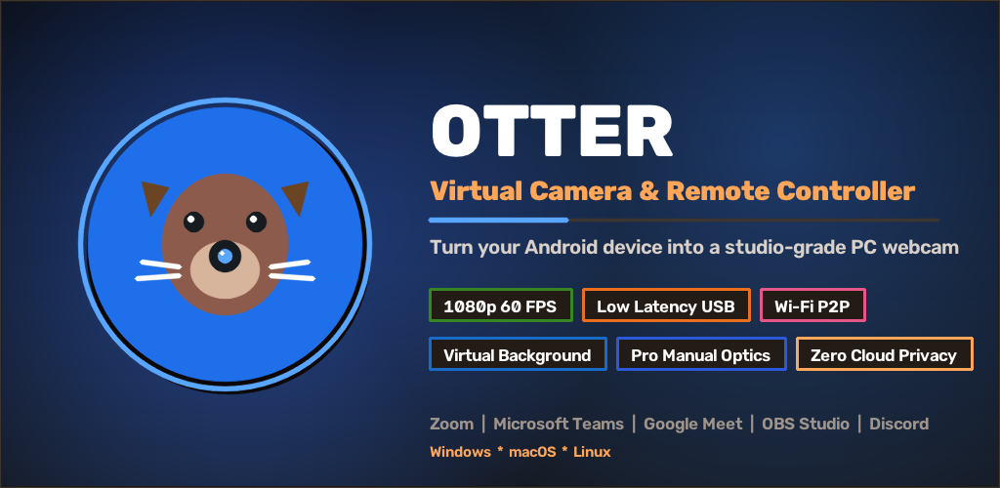
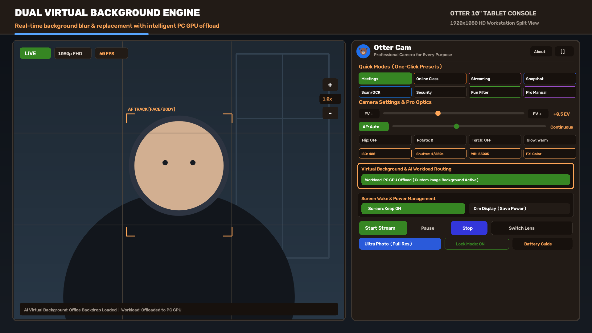
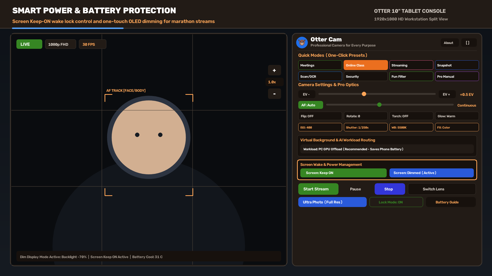
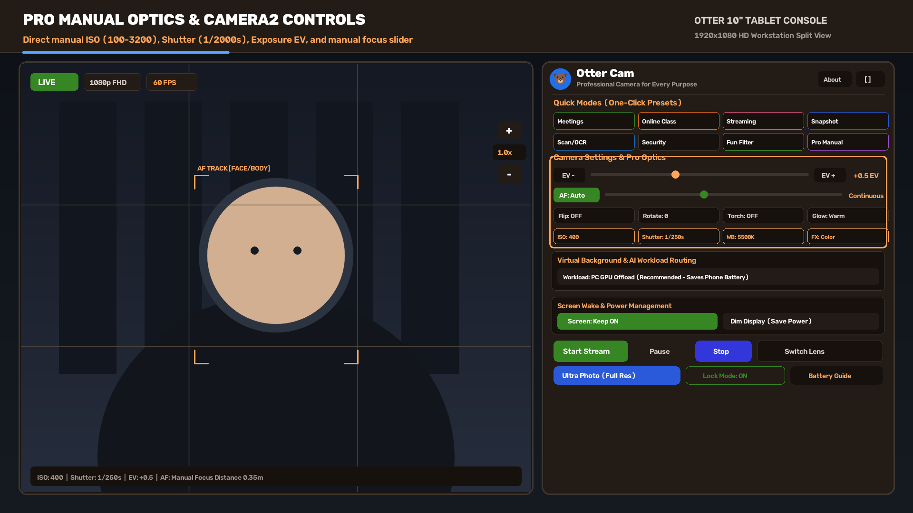
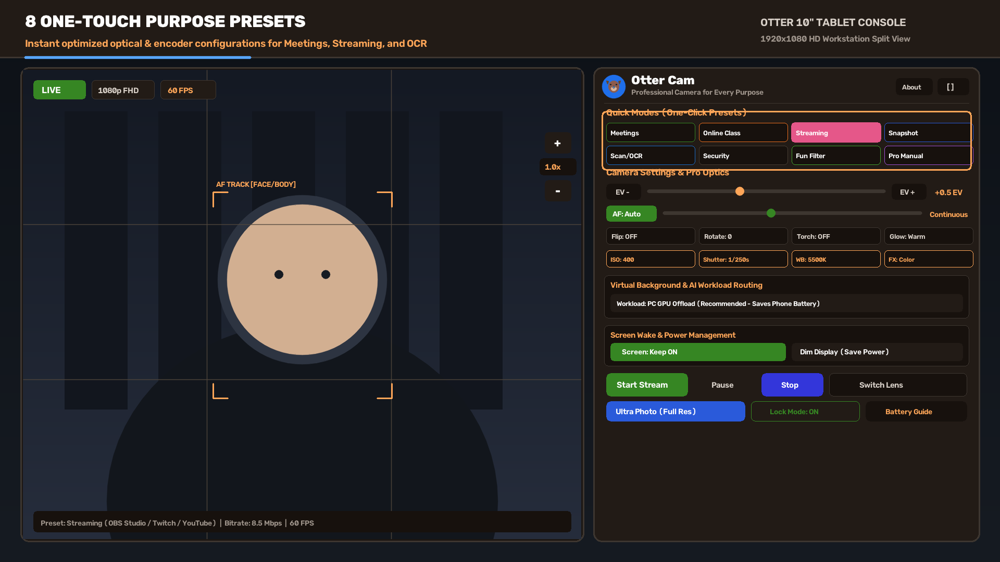

# Otter Master Guidebook

Comprehensive operational manual, architecture guide, and setup reference for Otter Virtual Camera and Remote Controller.

- **Developer**: spacecar
- **Repository**: [https://github.com/saprecar/Otter](https://github.com/saprecar/Otter)
- **Legal Suite**: [Policies And Agreement/POLICIES_AND_AGREEMENT.md](Policies%20And%20Agreement/POLICIES_AND_AGREEMENT.md)
- **License**: MIT Permissive Open-Source License with Mandatory Attribution

---

## Table of Contents
1. [Overview and High-Level Architecture](#1-overview-and-high-level-architecture)
2. [Connection Modes](#2-connection-modes)
   - [A. USB Cable Mode (Recommended)](#a-usb-cable-mode-recommended)
   - [B. Local Wi-Fi Mode](#b-local-wi-fi-mode)
   - [C. Android 14+ Native UVC Mode](#c-android-14-native-uvc-mode)
3. [Virtual Background & Workload Routing Engine](#3-virtual-background--workload-routing-engine)
   - [A. Workload Offload: PC GPU/CPU vs Mobile Processing](#a-workload-offload-pc-gpucpu-vs-mobile-processing)
   - [B. Virtual Background Modes](#b-virtual-background-modes)
   - [C. MediaPipe AI & Pure OpenCV Chroma Engine](#c-mediapipe-ai--pure-opencv-chroma-engine)
4. [Screen Wake & Battery Optimization](#4-screen-wake--battery-optimization)
   - [A. Keep Screen On Toggle](#a-keep-screen-on-toggle)
   - [B. Display Dim Mode](#b-display-dim-mode)
   - [C. Foreground Service & Background Lock](#c-foreground-service--background-lock)
5. [Pro Manual Optics & Controls](#5-pro-manual-optics--controls)
   - [A. Dynamic Resolutions & High FPS](#a-dynamic-resolutions--high-fps)
   - [B. ISO, Shutter Speed, and Exposure](#b-iso-shutter-speed-and-exposure)
   - [C. Auto & Manual Focus Distance](#c-auto--manual-focus-distance)
   - [D. White Balance and Creative Effects](#d-white-balance-and-creative-effects)
   - [E. Ultra Photo Capture (Full Sensor Resolution)](#e-ultra-photo-capture-full-sensor-resolution)
   - [F. Hardware Torch & Front Screen Glow Ring](#f-hardware-torch--front-screen-glow-ring)
   - [G. 360-Degree Rotation & Aspect-Preserving Pillarboxing](#g-360-degree-rotation--aspect-preserving-pillarboxing)
6. [Quick Modes (One-Click Purpose Presets)](#6-quick-modes-one-click-purpose-presets)
7. [Desktop Virtual Camera Integration](#7-desktop-virtual-camera-integration)
   - [Zoom](#zoom)
   - [Microsoft Teams](#microsoft-teams)
   - [Google Meet (Brave / Chrome / Firefox)](#google-meet-brave--chrome--firefox)
   - [Discord](#discord)
   - [OBS Studio](#obs-studio)
8. [OEM Background Anti-Kill Configuration](#8-oem-background-anti-kill-configuration)
9. [Troubleshooting & Frequently Asked Questions](#9-troubleshooting--frequently-asked-questions)
10. [Legal Terms, Attribution & Jurisdiction](#10-legal-terms-attribution--jurisdiction)

---

## 1. Overview and High-Level Architecture

<p align="center">
  
</p>

Otter transforms your Android mobile device into a professional, low-latency virtual webcam streaming uncompressed, studio-grade video directly to your desktop or workstation (Windows, macOS, Linux).

Unlike legacy webcam utilities, Otter operates on a **100% Peer-to-Peer (P2P), Zero-Cloud, Zero-Telemetry architecture**:
- Video frames never leave your local physical cable or local wireless router.
- No third-party accounts, cloud sign-ins, or telemetry beacons are present.
- Hardware-accelerated H.264 video encoding via Android `MediaCodec` provides low latency (sub-40ms over USB).
- Dual virtual camera drivers on Windows (DirectShow `UnityCapture` and universal `OBS Virtual Camera` fallback) and Linux `v4l2loopback` allow compatibility with every conferencing application.

```text
+-----------------------+                    +------------------------------------+
|  Android Device       |                    |  Desktop / Workstation PC          |
|  - Camera2 Hardware   |   USB Cable (ADB)  |  - CamBridge Receiver              |
|  - MediaCodec H.264   | -----------------> |  - Standalone FFmpeg Decoder       |
|  - Screen Wake Lock   |     or Local Wi-Fi |  - Virtual Background Engine (AI)  |
|  - Remote RPC Server  | <----------------- |  - DirectShow / OBS Virtual Camera |
+-----------------------+     RPC Commands   +-----------------+------------------+
                                                               |
                                            Feed to Video Apps v
                               +--------------------------------------------------+
                               | Zoom  |  MS Teams  |  Google Meet  |  OBS Studio |
                               +--------------------------------------------------+
```

---

## 2. Connection Modes

### A. USB Tethering Mode (Recommended - No Developer Mode or ADB Required)
USB Tethering uses Android's native hardware USB network interface (RNDIS / CDC-NCM) for high-speed wired streaming without needing ADB, USB debugging, or developer options:

1. **Plug in USB Cable**: Connect your phone to your PC with a standard USB data cable.
2. **Turn on USB Tethering**:
   - On Android: Open **Settings > Network & Internet > Hotspot & Tethering** and enable **USB Tethering** (or tap the USB notification and select USB Tethering).
   - *Quick Shortcut*: Tap or long-press the network label in the Otter mobile app to open Tethering settings directly.
3. **Connect Desktop**:
   - In Otter Desktop Controller, select **(o) USB Tethering**.
   - Otter automatically discovers the active USB tethering network adapter and dynamic default gateway (supports both dynamic Android Mainline subnets such as `10.x.x.x` and legacy static subnets like `192.168.42.129`).
   - Click **Connect & Start**. The connection initializes immediately over the USB wire with sub-40ms latency.
   - *Zero root, zero developer options, zero ADB commands, and zero driver setup required!*

### B. USB Cable Mode via ADB (Alternative Wired Port Forwarding)
USB Cable streaming via ADB port forwarding:

1. **Enable Developer Options on Android**:
   - Go to **Settings > About Phone**.
   - Tap **Build Number** 7 times until Developer Mode is activated.
2. **Enable USB Debugging**:
   - Go to **Settings > System > Developer Options**.
   - Toggle **USB Debugging** to ON.
3. **Connect Device to PC**:
   - Plug in your phone via a reliable USB data cable.
   - When the prompt *"Allow USB debugging?"* appears on your phone screen, check *"Always allow from this computer"* and tap **Allow**.
4. **Launch Otter Desktop**:
   - On the Desktop app, select **(o) USB (ADB Tunnel)**.
   - Click **Connect & Start**.
   - Otter automatically verifies the ADB connection, forwards ports (`8089` stream, `8090` control), and starts streaming with near-zero latency.

### C. Local Wi-Fi Mode
Wi-Fi mode allows wireless mobility anywhere within your local network without cables.

1. Connect your phone and PC to the **same Wi-Fi network**.
2. Open the Otter Android App. Note the IP address displayed at the bottom (e.g. `192.168.1.15`).
3. Open the Otter Desktop App.
4. Select **(o) Wi-Fi (LAN IP)**.
5. Click **Auto Detect IP** or manually enter the phone's IP address.
6. Click **Connect & Start**.

> [!NOTE]
> Wi-Fi performance depends on router proximity and 5GHz band utilization. If you encounter packet jitter on congested 2.4GHz networks, switch to USB Cable Mode.

### C. Android 14+ Native UVC Mode
For devices running Android 14 or higher that support native USB Video Class gadget mode:
- Connect the phone via USB.
- When prompted by Android for USB configuration, select **Webcam**.
- The phone acts as a driverless hardware UVC webcam without requiring any desktop client software.

---

## 3. Virtual Background & Workload Routing Engine

<p align="center">
  
</p>

Otter features a dual-execution Virtual Background replacement engine. You have complete control over where video processing workloads are executed:

### A. Workload Offload: PC GPU/CPU vs Mobile Processing

| Feature | Offload to PC GPU/CPU (Recommended) | Mobile Device Processing |
| :--- | :--- | :--- |
| **Phone Thermals** | **Ice Cold**: Phone only streams pristine camera feed | **High Heat**: Heavy on-device matrix math |
| **Battery Life** | **Maximum**: Hours of continuous streaming | Rapid battery consumption |
| **Frame Rate** | Smooth 60 FPS guaranteed | Prone to thermal throttling over prolonged calls |
| **Power Supply** | Uses desktop wall-power and active cooling fans | Relies on phone battery |
| **Best Used When** | PC has a multi-core CPU or dedicated GPU | PC is an ultra-low-spec legacy computer |

### B. Virtual Background Modes
You can select your desired background effect from either the Desktop Controller or Mobile App:
- **Off / Pass-Through**: Pristine, unfiltered camera feed with zero overhead.
- **Light Bokeh Blur (Portrait)**: Natural depth-of-field effect that subtly blurs your room while keeping you in sharp focus.
- **Heavy Privacy Blur**: Strong Gaussian privacy blur that conceals room details, whiteboards, or background distractions.
- **Solid Green Screen (Chroma Key)**: Generates a pure digital Chroma Green `(RGB 0, 255, 0)` background behind you, ready for instant keying in OBS Studio, Zoom, Discord, or vMix without requiring a physical green screen cloth.
- **Custom Image Background & Gallery Upload**: Select any custom image from your PC file browser or pick straight from your phone's Photo Gallery (`ACTION_GET_CONTENT`). Otter composites your silhouette cleanly over the image with feathered anti-aliased edges.
- **One-Click Presets**: Quick selection for Modern Office, Studio Bokeh, Minimalist Bookshelf, and Cozy Coffee Shop.
- **Physical Green Screen Chroma Key**: Professional studio HSV color keying (Hue 35-85) that seamlessly replaces real green or blue studio backdrops.

### C. MediaPipe AI & Pure OpenCV Chroma Engine
- **Built-in Pure OpenCV Engine**: Works out-of-the-box with zero third-party AI dependencies using high-speed HSV chroma keying and geometric portrait priors (~1ms per frame).
- **Optional MediaPipe Acceleration**: If you have `mediapipe` installed (`pip install mediapipe`), Otter automatically detects it and enables neural network selfie segmentation.

### D. Recommended Wallpaper Specifications & Sample Wallpapers
When choosing or creating custom background wallpapers for Otter:
- **Aspect Ratio**: **16:9** widescreen (matches standard 1080p / 720p webcam dimensions).
- **Recommended Resolutions**:
  - **1920 x 1080 (Full HD / 1080p)**: Optimal balance of high clarity and fast rendering.
  - **1280 x 720 (Standard HD / 720p)**: Recommended for lower-spec desktop hardware.
  - **3840 x 2160 (4K UHD)**: Ultra-crisp, automatically scaled to stream resolution.
- **Supported Formats**: `.png`, `.jpg`, `.jpeg`, `.webp`, `.bmp`.
- **File Size**: Up to **15 MB**. Otter loads and caches the scaled bitmap in RAM for zero latency.
- **Aspect Ratio Scaling**: Images in other aspect ratios (e.g. 4:3, 1:1, or 9:16) are automatically scaled to match camera resolution without distortion.
- **Built-In Sample Wallpapers** (located in `wallpapers/`):
  - `modern_office.jpg`: Executive office backdrop with soft daylight window illumination.
  - `studio_bokeh.jpg`: Dark studio backdrop with deep charcoal and soft amber/cyan bokeh.
  - `minimalist_bookshelf.jpg`: Warm wooden library bookshelf with ambient study lighting.
  - `cozy_coffee_shop.jpg`: Warm cafe interior with hanging pendant lighting.

---

## 4. Screen Wake & Battery Optimization

<p align="center">
  
</p>

During multi-hour meetings or livestreams, managing device power and display state is critical. Otter provides three dedicated power management tools:

### A. Keep Screen On Toggle
- **Screen: Keep ON** (Default): Keeps the mobile screen awake while the camera is active. Ideal when you want to monitor framing, lighting, and status badges directly on your phone mount.
- **Screen: Auto Sleep**: Disables the window wake lock (`FLAG_KEEP_SCREEN_ON`). Your phone will follow its normal Android display sleep timeout, saving substantial battery while video streaming continues uninterrupted in the background.
- **Sync**: Can be toggled on-device or remotely from the desktop client. Settings persist across app relaunches.

### B. Display Dim Mode
- Tap **Dim Display (Save Power)** on Android to reduce screen backlight brightness to the minimum possible level (`0.01`).
- The camera sensor and encoder continue operating at full fidelity, but display power consumption drops by up to 70%, preventing screen burn-in and reducing device heat.
- Tap the button again to restore normal screen brightness.

### C. Foreground Service & Live Camera Notification
- **Persistent Ongoing Notification**: Whenever the camera is streaming, Otter displays an ongoing status notification:
  - **Title**: `Otter Camera: LIVE` (or `Otter Camera: Paused`)
  - **Content**: `Camera is actively streaming on port 8089 (1920x1080 @ 60 FPS)`
  - **Subtext**: `Camera in use`
  - **Stop Stream Action**: A dedicated native `[Stop Stream]` button directly in the notification shade to terminate streaming instantly without bringing the app to the foreground.
- **Background Lock (`Lock Mode: ON`)**: Acquires an Android `PARTIAL_WAKE_LOCK` alongside the foreground service, preventing OEM task managers from suspending the camera feed or network sockets when the screen is locked.

---

## 5. Pro Manual Optics & Controls

<p align="center">
  
</p>

Otter gives you complete manual control over the phone camera hardware, bidirectionally synchronized between phone and PC:

### A. Dynamic Resolutions & High FPS
- Automatically queries the Camera2 HAL for hardware-supported video streams:
  - **4K UHD** (`3840x2160`)
  - **1080p FHD** (`1920x1080`)
  - **720p HD** (`1280x720`)
  - **480p SD** (`640x480`)
  - **360p Low** (`640x360`)
- Detects sensor FPS capabilities up to **60 FPS** for ultra-smooth video.

### B. ISO, Shutter Speed, and Exposure
- **ISO**: Auto, 100, 200, 400, 800, 1600, 3200.
- **Shutter Speed**: Auto, 1/2000s, 1/1000s, 1/500s, 1/250s, 1/125s, 1/60s, 1/30s, 1/15s.
- **Exposure Compensation (EV)**: Stepper buttons (`[ EV - ]` and `[ EV + ]`) and fine slider covering `-4.0 EV` to `+4.0 EV`.
- Auto-interlocks ensure that manual adjustment instantly disables Auto Exposure mode, while checking "Auto" returns the camera to continuous automatic metering.

### C. Auto & Manual Focus Distance
- Toggle between **AF: Auto** (continuous video autofocus) and **AF: Manual**.
- Manual focus slider allows fine control from **Macro (`0.1m`)** to **Infinity (`Inf`)**.

### D. White Balance and Creative Effects
- **White Balance**: Auto (AWB), Daylight (5500K), Cloudy (6500K), Fluorescent (4000K), Incandescent/Tungsten (2800K), Twilight, and Shade.
- **Creative Effects**: Normal Color, Black & White (Mono), Negative, Sepia, Solarize, and Posterize.

### E. Ultra Photo Capture (Full Sensor Resolution)
- Tap **Ultra Photo (Full Res)** on phone or desktop.
- Captures an uncompressed full-resolution still photo at the maximum physical sensor resolution (e.g. 64MP, 48MP, or 108MP) and saves it to your device's Pictures directory without disconnecting or interrupting the live video stream.

### F. Hardware Torch & Front Screen Glow Ring
- **Hardware Rear Flashlight**: Cycle through OFF, Low Strength, and High Strength to illuminate your face or desk.
- **Front Screen Glow Ring**: For front-facing cameras without a hardware flash, creates an adjustable ambient illumination ring on the phone screen with color temperature presets: Warm (Amber), Studio Daylight, Sunset, and Clean White.

### G. 360-Degree Rotation & Aspect-Preserving Pillarboxing
- Cycle rotation by **0°**, **90°**, **180°**, or **270°** to accommodate upside-down phone mounts or portrait desk stands.
- When rotated 90° or 270°, Otter automatically applies aspect-ratio preserving pillarboxing with black borders, preventing your video from being stretched or distorted in Zoom or Teams.

---

## 6. Quick Modes (One-Click Purpose Presets)

<p align="center">
  
</p>

Otter provides 8 optimized presets to configure camera parameters with a single tap:

1. **Meetings**: 720p/1080p, Auto Exposure, Continuous AF, Natural Color.
2. **Online Class**: High-clarity focus with +0.5 EV exposure boost for reading notes and face clarity.
3. **Streaming**: 60 FPS target, vivid saturation, high-speed shutter to eliminate motion blur.
4. **Snapshot**: Prepares camera pipeline for maximum-resolution still captures.
5. **Scan / OCR**: High-contrast, sharp text edges, lock focus for documents and whiteboards.
6. **Security Monitor**: 15 FPS low-bandwidth mode with auto-dim display to run continuously for days.
7. **Fun Filter**: Cycles creative color effects (Mono, Sepia, Negative).
8. **Pro Reset**: Restores all manual controls to default hardware Auto states.

---

## 7. Desktop Virtual Camera Integration

### Zoom
1. Open **Zoom > Settings > Video**.
2. Under **Camera**, select **Unity Video Capture** or **OBS Virtual Camera**.
3. Uncheck *"Mirror my video"* if you already enabled mirroring inside Otter.
4. Set **Original ratio** or **HD** for maximum clarity.

### Microsoft Teams
1. Open **Teams > Settings > Devices**.
2. Under **Camera**, choose **Unity Video Capture** or **OBS Virtual Camera**.
3. Verify video preview.

### Google Meet (Brave / Chrome / Firefox)
1. In a Google Meet call, click **More Options (three dots) > Settings > Video**.
2. Select **Unity Video Capture** or **OBS Virtual Camera**.
3. Set **Send resolution (maximum)** to **High definition (720p or 1080p)**.

### Discord
1. Go to **User Settings > Voice & Video > Video Settings**.
2. Under **Camera**, select **Unity Video Capture** or **OBS Virtual Camera**.
3. Click **Test Video** to confirm stream output.

### OBS Studio
1. In OBS Studio, add a **Video Capture Device** source.
2. Select **Unity Video Capture** or **OBS Virtual Camera**.
3. Set resolution to Match Output (`1920x1080` or `1280x720`).

### Gaming Consoles & Handheld Devices
- **Handheld PC Gaming Devices (Desktop OS)**:
  - Supported directly in Desktop Mode.
  - Run `./run_linux.sh` (or `run_windows.bat` on Windows-based handhelds) to initialize loopback video devices (`/dev/video*`). Select Otter directly in local broadcast or recording utilities.
- **Dedicated Gaming Consoles (Proprietary OS via Hardware Capture Bridge)**:
  - Gaming consoles enforce strict closed operating environments that only accept standard hardware USB Video Class (UVC) capture signals.
  - Setup via generic hardware video capture card:
    1. Connect phone to PC via Otter (USB Tethering, ADB Tunnel, or Wi-Fi).
    2. Open your preferred preview or OBS Studio window showing the Otter Virtual Camera feed.
    3. Connect an HDMI cable from your PC's video output to the HDMI input of a standard generic USB video capture card.
    4. Connect the USB output of the capture card directly into your console's USB port.
    5. The console detects the feed as a plug-and-play hardware camera for in-game streaming, overlays, and party chat.

---

## 8. OEM Background Anti-Kill Configuration

Android device manufacturers employ aggressive background task killers. To ensure uninterrupted streaming:

### Xiaomi / Redmi / POCO (MIUI / HyperOS)
- Go to **Settings > Apps > Manage Apps > Otter**.
- Set **Autostart** to **Allowed**.
- Set **Battery Saver** to **No Restrictions**.
- Open the Recent Apps tray, press and hold Otter, and tap the **Lock Icon**.

### Samsung (One UI)
- Go to **Settings > Battery and device care > Battery > Background usage limits**.
- Add Otter to **Never sleeping apps**.
- In **Settings > Apps > Otter > Battery**, select **Unrestricted**.

### Vivo / iQOO (Funtouch OS / OriginOS)
- Go to **Settings > Battery > Background power consumption management**.
- Find Otter and select **High background power usage allowed**.
- In Recent Apps, pull down on Otter and lock it.

### Oppo / Realme / OnePlus (ColorOS / OxygenOS)
- Go to **Settings > Battery > More battery settings > App battery management > Otter**.
- Enable **Allow background activity** and **Allow auto-launch**.
- Lock Otter in the recent tasks screen.

---

## 9. Troubleshooting & Frequently Asked Questions

### Phone not detected via USB?
- Ensure **USB Debugging** is enabled in Developer Options.
- Try switching the USB connection mode in the Android notification shade from *Charging Only* to *File Transfer (MTP)*.
- Run `adb devices` in a terminal. If it says `unauthorized`, look at your phone screen and accept the USB debugging RSA key prompt.

### Virtual Camera not showing in Zoom / Meet?
- On Windows, verify that DirectShow or OBS VirtualCam driver is active.
- If using OBS VirtualCam, ensure OBS Studio is installed or launch Otter Desktop with administrator permissions once to register DirectShow shared memory filters.

### Video is lagging or dropping frames?
- If using Wi-Fi, ensure your phone and PC are connected to a 5GHz Wi-Fi band, or switch to USB Cable Mode.
- Lower target resolution from 4K/1080p to 720p in the Resolution selector.
- *Notice on Initial Start*: During stream negotiation, a brief 1-2 second pause is normal while encoder keyframes synchronize.

### Why does a black terminal window open on Windows?
- Running `run_windows.bat` opens a command prompt window to show environment checks and real-time streaming logs. It is completely safe and normal.
- If you prefer to hide the terminal window completely, launch Otter by double-clicking **`run_windows_silent.vbs`**.

### VPN or Firewall blocking stream connection?
- **VPN**: Commercial VPNs often route all traffic into virtual interfaces and block local LAN socket connections (ports `8089` and `8090`). Disable your VPN temporarily or allow local LAN bypass / split-tunneling.
- **Firewall**: When prompted by Windows Defender Firewall, check the box for **Private Networks** and click **Allow access**. Inbound TCP ports `8089` (video) and `8090` (control) must be open.

### Manual Dependency Installation Commands (All OS)
*Note: An active internet connection is required only during package download/setup.*
- **Windows**:
  ```cmd
  pip install opencv-python numpy pyvirtualcam imageio-ffmpeg
  ```
- **Linux (Ubuntu/Debian)**:
  ```bash
  sudo apt update && sudo apt install -y python3 python3-pip python3-tk python3-venv v4l2loopback-dkms
  pip3 install opencv-python numpy pyvirtualcam imageio-ffmpeg
  ```
- **Linux (Fedora)**:
  ```bash
  sudo dnf install -y python3 python3-pip python3-tkinter v4l2loopback
  pip3 install opencv-python numpy pyvirtualcam imageio-ffmpeg
  ```
- **macOS**:
  ```bash
  brew install python python-tk && pip3 install opencv-python numpy pyvirtualcam imageio-ffmpeg
  ```

### Google Play Protect Warning during APK Sideloading
- When sideloading Otter APK outside the Play Store, Google Play Protect may show an "Unrecognized app" dialog.
- Users can safely scan or select **"Install without scanning" / "Install anyway"**. Otter is 100% open-source and transmits zero data outside your local network.
- **Android Compatibility**: Non-Play Store APK supports **Android 5.0 (API 21) up to Android 16+**; Play Store release supports **Android 7.0 (API 24) up to Android 16+**.

---

## 10. Legal Terms, Attribution & Jurisdiction

### P2P Zero-Cloud Architecture & No Developer Data Retention
Otter operates entirely peer-to-peer across your local hardware interfaces. The developer does not maintain servers, databases, or cloud infrastructure. No video packets, audio streams, IP addresses, or device IDs are recorded or stored.

### Google Play Store & Android 16 (API 36) Compliance
- **Application ID / Package**: `org.understory.cambridge` (Public Display Name: `Otter`).
- **Target SDK**: Android 16 (API Level 36) - Fully compliant with latest Google Play target API level mandates.
- **Data Safety Declaration**: "Encrypted in transit: No" (truthfully declared because local peer-to-peer streaming uses raw local TCP sockets across LAN/USB without an application-layer TLS certificate wrapper).
- **Restricted Permissions Compliance**: `REQUEST_IGNORE_BATTERY_OPTIMIZATIONS` is omitted from `AndroidManifest.xml` to prevent Play Store policy rejections; users are guided to system battery settings via standard intents.
- **Foreground Service**: `FOREGROUND_SERVICE_CAMERA` declared with `foregroundServiceType="camera"` for active webcam streaming when the screen is dimmed or backgrounded.
- **Statutory Privacy Compliance**: Strictly adheres to Section 66E (Violation of Privacy) and Section 67 (Transmitting Obscene Material) of the Indian Information Technology Act, 2000.

### Mandatory Attribution Clause
Under the MIT License terms of Otter, any fork, derivation, redistribution, or packaging of this project must prominently display:
1. Original Developer Credit: `spacecar`
2. Official Repository Link: `https://github.com/saprecar/Otter`
3. Unaltered notice of the consolidated policy document.

### Exclusive Legal Jurisdiction
All disputes, inquiries, or legal claims arising from the use of Otter are subject to the exclusive jurisdiction of the **Competent Courts of Narmadapuram, Madhya Pradesh, India (PIN: 461001 / 461005)**, under the laws of the Republic of India.

### Official Contact
- **Direct Email**: `getspacecar@gmail.com`
  - *Mandatory Subject Prefix*: `[Otter-Legal]` or `[Otter-Inquiry]`
- **Official GitHub Issues**: [https://github.com/saprecar/Otter/issues](https://github.com/saprecar/Otter/issues)
