<p align="center">
  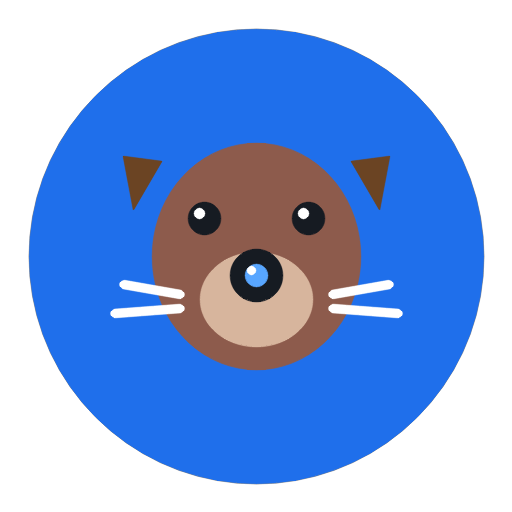
</p>

<h1 align="center">Otter - Virtual Webcam & Remote Control Suite</h1>

<p align="center">
  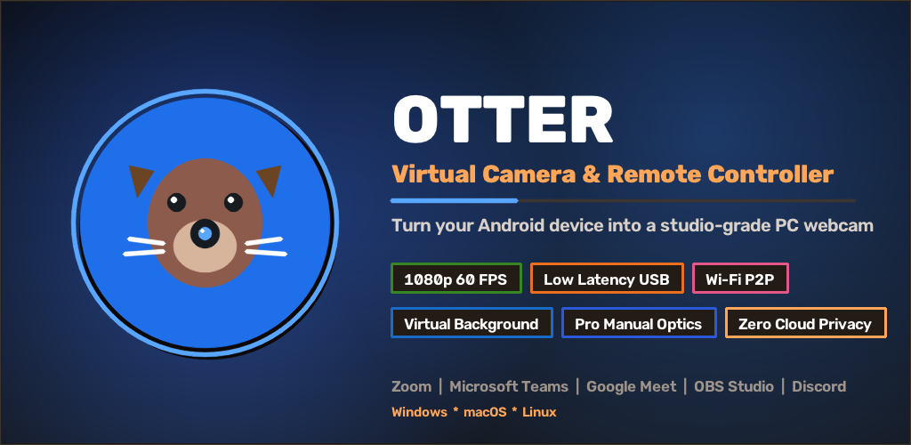
</p>

<p align="center">
  <b>Turn your Android phone, tablet, iPhone, or iPad into a studio-grade PC webcam.</b><br>
  Native Android App & Zero-Install Mobile Web Streamer | 1080p 60 FPS | Zero-Latency ADB Tunnel | USB Tethering | Pro Optics | AI Virtual Background | 100% Private P2P
</p>

<p align="center">
  <a href="https://github.com/saprecar/Otter">Official GitHub</a> |
  <a href="GUIDEBOOK.md">Master Guidebook</a> |
  <a href="Policies%20And%20Agreement/POLICIES_AND_AGREEMENT.md">Policies & Agreement</a> |
  <a href="STORE_LISTING.md">Store Listing</a>
</p>

---

## Visual Overview & Application Interface

| Desktop Virtual Camera Controller | Android Mobile Camera Client |
| :---: | :---: |
| 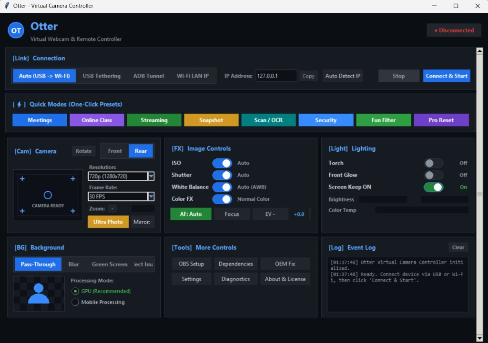 | 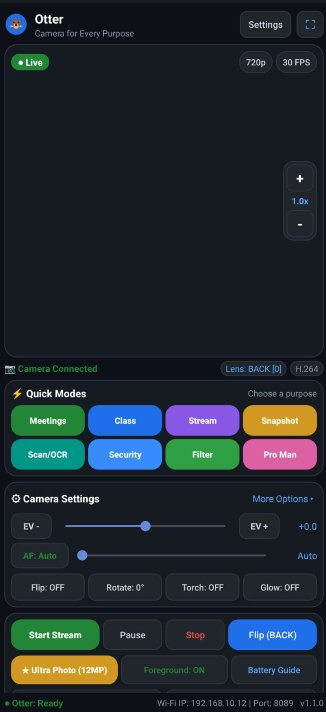 |
| **Complete PC Virtual Webcam Console**<br>Connection Modes, Pro Optics, AI BG, Lighting & Live Logs | **Streamlined Mobile Viewfinder**<br>Camera2 Hardware Pipeline, Quick Modes, Manual Controls |

### Tablet Console & Feature Showcase

| 1080p 60 FPS Streaming | Pro Manual Optics & Camera2 Controls |
| :---: | :---: |
| 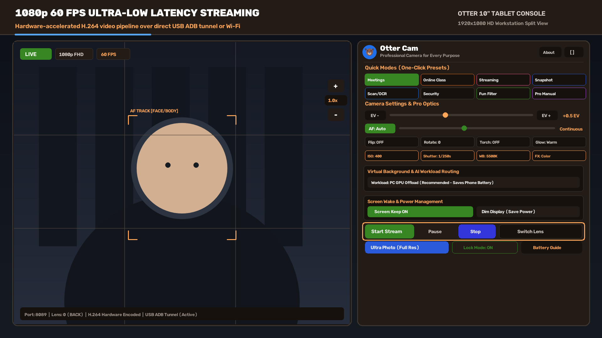 | 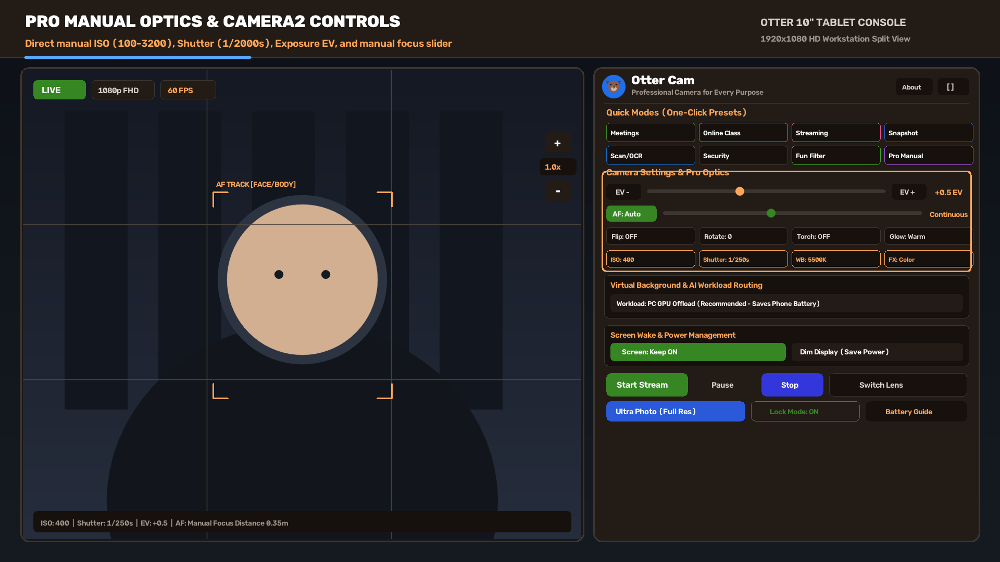 |
| **Dual Virtual Background (PC GPU Offload)** | **8 One-Touch Purpose Presets** |
| 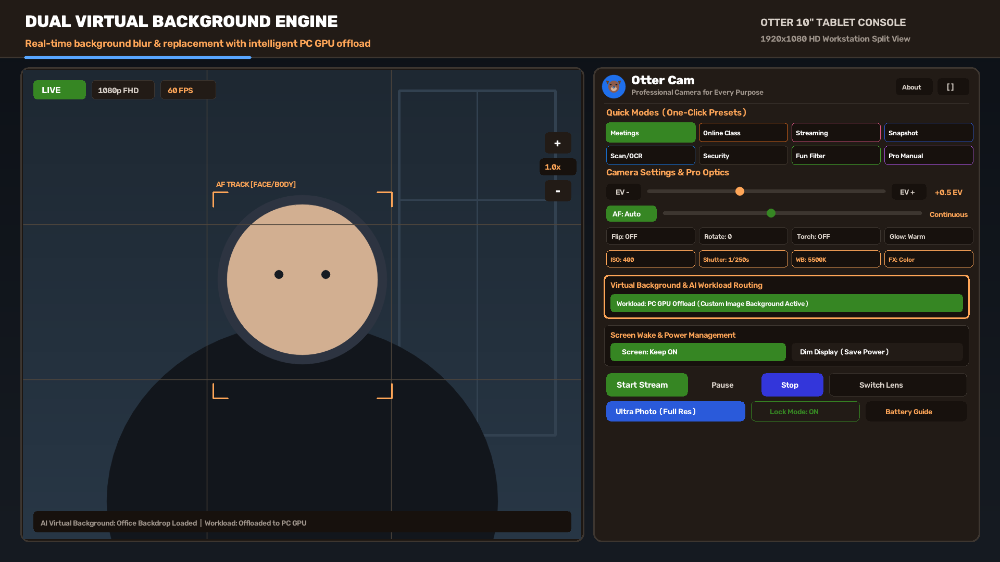 | 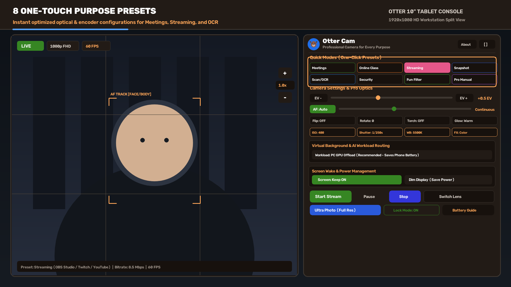 |
| **Smart Power & Display Dimming** | **100% Private Zero-Cloud Architecture** |
| 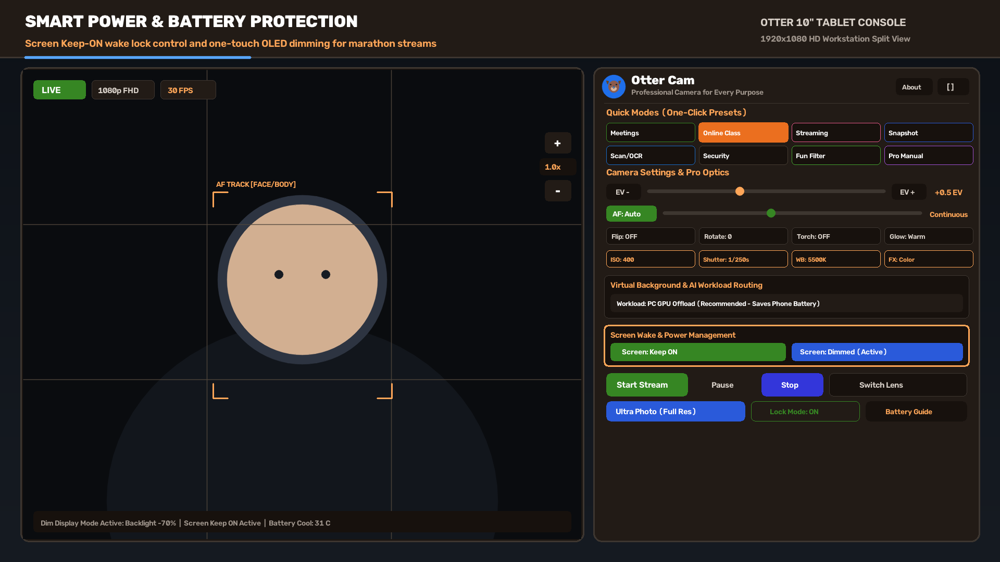 | 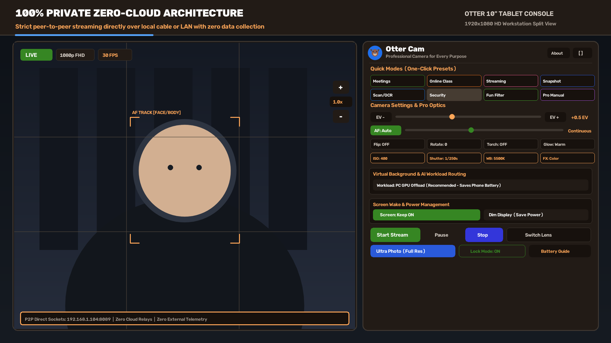 |
| **Multi-Lens Switching & 4K Ultra Photo** | **Universal Compatibility (OBS, Zoom, Teams)** |
| 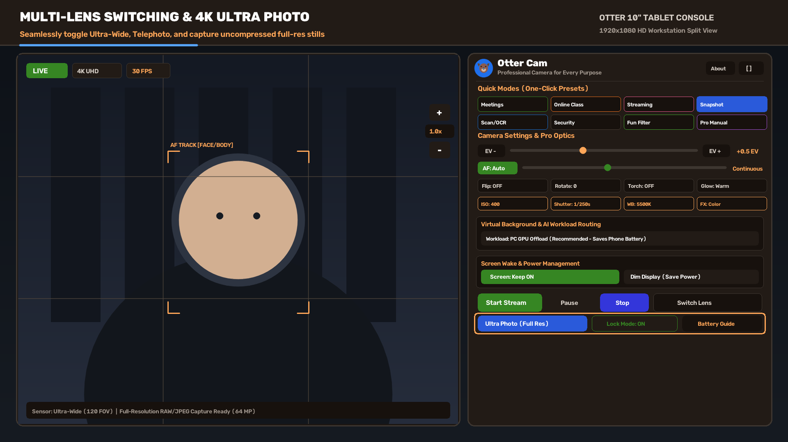 | 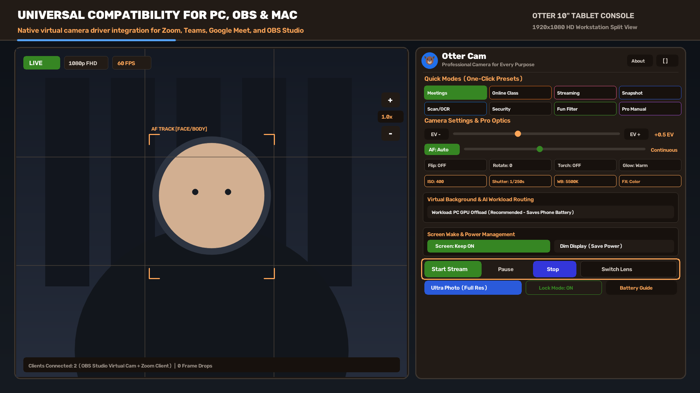 |

---

## What Does Otter Do?

**Otter** captures high-definition video directly from your Android phone's Camera2 hardware pipeline, encodes it with low-latency hardware H.264 (`MediaCodec`), and streams it to your PC over a USB cable (zero-latency ADB tunnel or USB Tethering) or local Wi-Fi.

On your computer, the Otter Desktop receiver broadcasts the stream into an OS-level virtual camera that functions seamlessly with:
- **OBS Studio & Streamlabs**
- **Discord**
- **Google Meet, Zoom & Microsoft Teams**
- **Web Browsers (Brave, Chrome, Firefox, Edge)**

### Universal Web UI & Zero-Install Browser Streamer (iOS & Android)
In addition to the native desktop application and Android app, Otter provides:
1. **Universal Cross-Platform Web Controller**: Launch with `run_web_ui_windows.bat` on Windows or `./run_linux.sh` / `./run_macos.sh` on Linux/macOS. Controls camera optics, virtual backgrounds, and virtual webcam outputs directly from your browser.
2. **Zero-Install Mobile Web Streamer**: Stream live camera video directly from:
   - **Apple iOS & iPadOS**: iPhone and iPad running **Safari** (iOS 11+).
   - **Android Phones & Tablets**: Google **Chrome**, **Brave**, **Firefox**, and **Samsung Internet**.
   - Simply scan the QR code displayed on the desktop web dashboard to start streaming immediately with zero app installations or Apple developer accounts required!

---

## Device & Platform Compatibility

Otter supports both native application installs and zero-install browser streaming across all major ecosystems:

| Platform / Device | Mode | Supported Versions / Browsers | Highlights |
| :--- | :--- | :--- | :--- |
| **Android Phones & Tablets** | **Native App (APK)** | Android 5.0 (API 21) up to Android 16+ | Direct Camera2 hardware pipeline, 60 FPS, hardware H.264 encoder, manual pro optics. |
| **Android Phones & Tablets** | **Web Streamer (Browser)** | Chrome, Brave, Firefox, Samsung Internet | Zero installation. Open streamer link or scan QR code. |
| **Apple iPhone & iPad** | **Web Streamer (Browser)** | Safari (iOS / iPadOS 11+) | Zero app install, no App Store or Apple Developer account required. Strictly locked portrait layout. |
| **Windows PC** | **Desktop Controller** | Windows 10, 11 (64-bit / 32-bit) | Web UI dashboard + DirectShow `Unity Video Capture` & `OBS Virtual Camera` drivers. |
| **Linux PC** | **Desktop Controller** | Ubuntu, Debian, Fedora, Arch, Mint | Web UI dashboard + native `v4l2loopback` (`/dev/video*`) kernel webcam bridge. |
| **macOS (Intel & Apple Silicon)** | **Desktop Controller** | macOS 12 Monterey up to macOS 15+ Sequoia | Web UI dashboard + CoreMediaIO DAL virtual camera bridge. |

---

## Mobile Browser Camera Permissions & Secure Context Guide (HTTP LAN)

Modern mobile browsers implement strict security standards (W3C Secure Context) that guard `navigator.mediaDevices.getUserMedia` when accessing web pages over local HTTP Wi-Fi IP addresses (`http://192.168.x.x`):

### 1. Google Chrome, Brave & Samsung Internet (Android)
If the camera fails to activate with *"Cannot read properties of undefined (reading 'getUserMedia')"*, it is because Chrome/Brave blocks camera access on non-secure (plain HTTP) LAN IP addresses by default.

**Easy 1-Minute Fix:**
1. In your mobile browser's address bar, type:
   - Chrome: `chrome://flags/#unsafely-treat-insecure-origin-as-secure`
   - Brave: `brave://flags/#unsafely-treat-insecure-origin-as-secure`
2. Set the flag to **Enabled**.
3. In the text box directly underneath, paste your desktop server origin (e.g. `http://192.168.1.50:8080`).
4. Tap **Relaunch** at the bottom of your screen.
5. Reload the Otter streamer page and tap **Allow** when prompted for camera access.

> **Zero-Flag Alternative (USB ADB Reverse Tethering)**:
> If connected via USB cable with USB Debugging enabled, run `adb reverse tcp:8080 tcp:8080` on your PC. Then on your phone, open `http://localhost:8080/streamer`. Chrome treats `localhost` as natively secure and enables camera access immediately without changing any flags!

### 2. Apple Safari (iPhone & iPad)
- Safari on iOS allows local camera access on local LAN IP addresses once you grant permission.
- When prompted with *"streamer wants to use your camera"*, tap **Allow**.
- Ensure Safari camera permissions are active in **Settings > Safari > Camera > Allow**.

### 3. Mozilla Firefox (Android)
- Firefox on Android prompts for camera access directly on local LAN addresses without requiring secure context flags. Tap **Allow** to stream.

---

## Connecting Otter to OBS Studio, Discord, Google Meet, Zoom & Teams

When running the **Otter Universal Web UI Controller** (`run_web_ui_windows.bat` on Windows, `./run_linux.sh` on Linux, `./run_macos.sh` on macOS), video from either your Android phone or mobile web streamer is bridged into your streaming and conference applications:

### 1. OBS Studio & Streamlabs
You can bring Otter into OBS in **two different ways**:

- **Method A: Direct Video Capture Device (Virtual Webcam)**
  1. Open OBS Studio -> In the **Sources** box, click **+** -> select **Video Capture Device**.
  2. Select your platform virtual camera device:
     - **Windows**: Select `Unity Video Capture` or `OBS Virtual Camera`.
     - **Linux**: Select `Otter Camera` or `/dev/video10` (via `v4l2loopback`).
     - **macOS**: Select `OBS Virtual Camera` (via CoreMediaIO DAL plugin).
  3. Click **OK**. The high-definition stream appears instantly just like a physical USB webcam.

- **Method B: Browser Source (Zero Driver Installation)**
  1. In OBS Studio, click **+** under **Sources** -> select **Browser**.
  2. In the URL field, enter your active dynamic MJPEG URL:
     ```text
     http://localhost:<PORT>/mjpeg
     ```
     *(The exact port and full URL are displayed and copyable in 1 click directly inside the Otter Web UI header under "Live OBS / Browser Stream URL")*
  3. Set Width to `1280` and Height to `720` (or `1920x1080` for 1080p).
  4. Click **OK**. OBS streams the decoded video feed directly over your local loopback network with zero virtual camera drivers required!

### 2. Discord
1. Open Discord -> Go to **User Settings** (gear icon) -> **Voice & Video**.
2. Scroll down to **Video Settings** -> **Camera**.
3. In the dropdown, select:
   - **Windows**: `Unity Video Capture` or `OBS Virtual Camera`.
   - **Linux**: `Otter Camera` / `/dev/video10`.
   - **macOS**: `OBS Virtual Camera`.
4. Click **Test Video** to confirm your feed is live.

### 3. Google Meet (Web Browser)
1. Join or start a meeting on Google Meet in Brave, Chrome, Firefox, or Edge.
2. Click the **More Options** (three vertical dots) at the bottom -> **Settings** -> **Video**.
3. Under **Camera**, choose:
   - `Unity Video Capture` or `OBS Virtual Camera` (Windows)
   - `Otter Camera` (Linux)
   - `OBS Virtual Camera` (macOS)
4. Set Send resolution to **High definition (720p)** for crisp output.

### 4. Zoom
1. Open Zoom -> Click **Settings** (gear icon at top right) -> **Video**.
2. In the **Camera** dropdown, select:
   - `Unity Video Capture` or `OBS Virtual Camera` (Windows)
   - `Otter Camera` (Linux)
   - `OBS Virtual Camera` (macOS)
3. Ensure **Original ratio** and **HD** are checked for full 16:9 widescreen fidelity.

### 5. Microsoft Teams
1. Open Microsoft Teams -> Click your profile/three dots menu -> **Settings** -> **Devices**.
2. Scroll to the **Video settings** section.
3. In the **Camera** dropdown, select:
   - `Unity Video Capture` or `OBS Virtual Camera` (Windows)
   - `Otter Camera` (Linux)
   - `OBS Virtual Camera` (macOS)
4. Confirm the preview is visible in the test viewport.

> **ROOT NOT REQUIRED**: Otter does **NOT** require root access on your phone. It runs completely on standard, unrooted stock Android operating systems.

---

## Android Version Compatibility

Otter provides two builds tailored for different Android ecosystems:

| Distribution Package | Supported Android Versions | Highlights |
| :--- | :--- | :--- |
| **Non-Play Store (GitHub Sideload / F-Droid)** | **Android 5.0 (API Level 21) up to Android 16+** | Maximum backwards compatibility for older devices, direct APK download, no Google services required. |
| **Google Play Store Version** | **Android 7.0 (API Level 24) up to Android 16+** | Compliant with Google Play Automatic Protection policies and modern Android background service rules. |

### Note on Google Play Protect (Sideloading APK)
When manually installing the APK downloaded from GitHub Releases:
- Google Play Protect may show a warning dialog ("Unrecognized app" or "Scan app").
- This is standard Android security behavior for apps installed outside the Google Play Store.
- You can choose to scan the app first. Alternatively, you may select "Install without scanning" / "Install anyway" to proceed, but doing so means bypassing Google's security checks. Please understand the potential risks before proceeding. Installing the APK is entirely user own choice and responsibility.

### Android APK Installation & Security

Both **signed and unsigned APKs** may trigger Google Play Protect or Android security warnings when installing apps outside the Play Store.

You can choose to scan the app first. Alternatively, you may select "Install without scanning" / "Install anyway" to proceed, but doing so means bypassing Google's security checks. Please understand the potential risks before proceeding. Installing the APK is entirely your own choice and responsibility.

Otter is **open-source (MIT license)**, contains no ads or telemetry, and is designed to work without transmitting your data to external cloud servers.

If you are unsure whether the APK is safe:

- You can review the source code yourself.
- You can ask a developer or someone knowledgeable in Android/Ios and other OS(operating system) etc security to inspect it.
- If you are not a developer, you can copy the GitHub repository link below and share it with any AI assistant to help review the code for potential malware, suspicious behavior, vulnerabilities, unnecessary permissions, or privacy risks.

**Repository:** https://github.com/saprecar/Otter

**Suggested AI Security Review Prompt (Optional): You may use the prompt below to ask an AI to review the source code for potential security risks. However, AI reviews are not guaranteed to be accurate or complete and may miss vulnerabilities or produce false positives. The review is only a reference, not a security guarantee. Users are responsible for their own assessment and decision to install the application.**

> Review this open-source Android application repository for security and privacy risks. Analyze the code for potential malware, suspicious behavior, data collection, telemetry, tracking, unexpected network communication, cloud data transmission, unsafe permissions, credential theft, hidden functionality, and other security vulnerabilities.
>
> Do not assume the application is safe simply because it is open-source. Trace the relevant code where possible, distinguish confirmed issues from potential risks, and provide evidence (file names and code references) for your findings. Also identify anything that appears safe and explain the limitations of your review.
>
> Repository: https://github.com/saprecar/Otter

**Install only if you are comfortable with the risks and trust the source of the APK.**

---

## How to Connect: 3 Connection Methods (+ Auto Mode)

Otter supports three dedicated connection protocols with automatic network detection:

### Method 1: USB Tethering (Easiest - No ADB or Developer Options Required)
1. Connect your Android phone to your PC using a standard USB cable.
2. On your phone, go to **Settings** -> **Portable Hotspot / Network & Internet** and turn ON **USB Tethering** (or tap the USB notification and select "USB Tethering").
3. Launch Otter on your phone and tap **Start Stream**.
4. In Otter Desktop on your PC, click **USB Tethering**. The client automatically detects the dynamic host gateway (e.g. `10.x.x.x` or `192.168.42.x`).
5. Click **Connect & Start**.
*No developer mode, no ADB authorization, and no special drivers needed!*

### Method 2: ADB Tunnel (USB Cable with Zero-Latency Port Forwarding)
1. On your phone, enable **Developer Options** (Settings -> About Phone -> tap *Build Number* 7 times).
2. In **Developer Options**, turn ON **USB Debugging**.
3. Connect your phone via USB cable and tap **Allow / Always allow from this computer** when prompted.
4. In Otter Desktop on your PC, select **ADB Tunnel** (the IP address automatically sets to `127.0.0.1`).
5. Click **Connect & Start**. Otter automatically handles port forwarding (`8089` and `8090`).
*Recommended for streaming at 1080p 60 FPS while keeping the phone continuously charged.*

### Method 3: Wi-Fi LAN IP (Wireless Mode)
1. Ensure both your phone and PC are connected to the same Wi-Fi router or access point.
2. Open Otter on your phone and note the local IP displayed at the bottom (e.g. `192.168.1.50`).
3. Tap **Start Stream** on your phone.
4. In Otter Desktop, select **Wi-Fi LAN IP**, verify the IP address (or click **Auto Detect IP**), and click **Connect & Start**.

### Method 4: Auto (USB -> Wi-Fi)
Selecting **Auto (USB -> Wi-Fi)** inspects active connections in priority order: it checks for an active USB tethering gateway or ADB device first, and automatically falls back to your local Wi-Fi network if no wired connection is detected.

---

## Desktop Launchers: Terminal vs. Silent Mode

Otter Desktop provides two launcher options across all supported desktop operating systems:

| Platform | Silent Launcher (Hidden Terminal) | Standard Launcher (With Console Window) |
| :--- | :--- | :--- |
| **Windows** | `run_windows_silent.vbs` | `run_windows.bat` |
| **Linux** | `run_linux_silent.sh` | `run_linux.sh` |
| **macOS** | `run_macos_silent.command` | `run_macos.command` / `run_macos.sh` |

### Terminal Window Explanation: Why Does It Open and How to Hide It?
- **Standard Launcher (`run_windows.bat`)**: Launches Otter with a visible command prompt / terminal window. This terminal runs the startup environment check and prints real-time connection logs, frame statistics, and error messages. **Do not be worried or scared by the black terminal window!** It is completely safe and normal for Python development applications.
- **Silent Launcher (`run_windows_silent.vbs`)**: If you prefer a clean desktop experience without any console window appearing on your screen, simply double-click `run_windows_silent.vbs`. It runs Otter Desktop completely silently in the background while displaying only the graphical user interface.

---

## Python Dependency Setup & Manual Installation Commands

Otter Desktop automatically creates an isolated virtual environment (`.venv`) and installs its requirements on first launch. If Python is not yet installed on your system:

1. Visit the official Python download page: [https://www.python.org/downloads/](https://www.python.org/downloads/)
2. Download the installer for your operating system (Python 3.9, 3.10, 3.11, or 3.12+).
3. **CRITICAL STEP**: On the first installer screen, make sure to check the box:
   **`[x] Add python.exe to PATH`** (or *Add Python to PATH*) before clicking "Install Now".
4. Complete the installation.
5. Double-click `run_windows_silent.vbs` or `run_windows.bat`. Otter will automatically configure all necessary libraries.

> **INTERNET CONNECTION REQUIRED FOR SETUP**: An active internet connection is strictly required **only during the first launch or when running the pip installation commands below** so Python can download and install packages from PyPI. Once installed, Otter runs 100% locally and completely offline with zero internet required!

### Manual Dependency Installation Commands (Copy & Paste by OS)

If auto-installation fails due to firewall, proxy, or missing system packages, open your terminal / command prompt and run the commands for your operating system:

#### Windows (Command Prompt or PowerShell)
```cmd
python -m pip install --upgrade pip
pip install opencv-python numpy pyvirtualcam imageio-ffmpeg
```
*(If using the desktop client folder with requirements.txt: `pip install -r requirements.txt`)*

#### Linux (Ubuntu / Debian / Linux Mint)
```bash
# 1. Install system prerequisites (Python, Tkinter GUI, and V4L2 virtual camera driver)
sudo apt update && sudo apt install -y python3 python3-pip python3-tk python3-venv v4l2loopback-dkms

# 2. Install Python packages
python3 -m pip install --upgrade pip
pip3 install opencv-python numpy pyvirtualcam imageio-ffmpeg
```

#### Linux (Fedora / RHEL)
```bash
sudo dnf install -y python3 python3-pip python3-tkinter v4l2loopback
pip3 install opencv-python numpy pyvirtualcam imageio-ffmpeg
```

#### Linux (Arch Linux / Manjaro)
```bash
sudo pacman -S --needed python python-pip tk v4l2loopback-dkms
pip install opencv-python numpy pyvirtualcam imageio-ffmpeg
```

#### macOS (Terminal with Homebrew)
```bash
# 1. Install Python and Tkinter via Homebrew
brew install python python-tk

# 2. Install Python packages
pip3 install opencv-python numpy pyvirtualcam imageio-ffmpeg
```

*Note for all operating systems: If pip install fails, check your internet connection, disconnect active VPNs that might block pip/PyPI connections, and re-run the commands above.*

---

## Troubleshooting & Common Questions

### 1. Connection Times Out or Cannot Find Camera IP
- Verify that the IP address in the Desktop Client matches the IP displayed at the bottom of the Otter mobile app.
- Click **Auto Detect IP** to refresh adapter addresses.
- If using USB Tethering, ensure tethering is toggled ON in your phone settings before starting the stream.

### 2. VPN Interference (LAN Connection Blocked)
- Commercial VPN services (e.g. NordVPN, ExpressVPN, ProtonVPN, corporate VPNs) often redirect all network routing through encrypted virtual adapters and block local private subnet communication.
- **Solution**: Temporarily pause or turn off your VPN, or enable **"Allow local network traffic / Split Tunneling"** in your VPN client settings so ports `8089` and `8090` can communicate locally.

### 3. Windows Defender, Antivirus or Firewall Block
- On first launch, Windows Defender or your firewall may show a prompt asking whether Python or Otter can access the network.
- **Solution**: Check the box for **Private Networks** and click **Allow access**.
- If previously blocked, open Windows Defender Firewall -> *Allow an app or feature through Windows Defender Firewall* -> ensure `python.exe` and `Otter` are allowed on Private networks, or open inbound TCP ports `8089` (video stream) and `8090` (control RPC).

### 4. UI Responsiveness & Initial Stream Lag
- **Notice**: During initial connection establishment, camera lens switching, or resolution changes, the desktop preview canvas or UI controls may experience a brief 1 to 2-second pause.
- **Why this happens**: The hardware video encoder (`MediaCodec`) and PC decoder pipeline negotiate keyframes and buffer sizing.
- **Resolution**: Do not worry on this part — this is normal during encoder handshaking and stabilizes into smooth 30/60 FPS streaming immediately after the first keyframe arrives.

---

## Gaming Consoles & Handheld Devices Setup

### 1. Handheld PC Gaming Devices (Desktop OS)
Handheld gaming systems running desktop operating systems (Linux or Windows) are natively supported:
1. Switch to Desktop Mode on your handheld device.
2. Run `run_linux.sh` (or `run_windows.bat` on Windows-based handhelds).
3. The video feed binds to standard system video loopback devices and can be selected directly inside native recording or streaming software.

### 2. Dedicated Gaming Consoles (Proprietary Systems via Capture Bridge)
Dedicated gaming consoles use closed operating systems that strictly require hardware USB Video Class (UVC) inputs and do not permit third-party desktop background utilities. You can route Otter's high-definition video into your console using a generic hardware video capture bridge:

1. **Stream to PC**: Connect your phone to your computer using Otter (USB Tethering, ADB Tunnel, or Wi-Fi).
2. **Launch Preview**: Open your preferred broadcast utility or video preview window displaying the Otter Virtual Camera feed.
3. **Connect Hardware Video Capture Card**:
   - Connect an HDMI cable from your PC's secondary display output into the HDMI input of a standard generic USB video capture card.
   - Plug the USB output of the capture card directly into any available USB port on your gaming console.
4. **Console Camera Detection**: The console immediately detects the USB capture card as a standard hardware video camera device, enabling live camera feeds for console broadcasts, commentary, and in-game overlays.

---

## Key Features

1. **Dual-Execution Virtual Background Engine**:
   - **PC GPU/CPU Offload (Recommended)**: Keeps your phone cool and preserves battery while your computer handles real-time background blur, custom images, and chroma keying.
   - **Mobile Processing**: Standalone processing directly on your phone.
   - **Background Modes**: Custom background image, light portrait bokeh blur, heavy privacy blur, and green screen chroma keying.

2. **Smart Power & Battery Protection**:
   - **Keep Screen On Toggle**: User-selectable switch to keep display awake or allow device auto-sleep.
   - **Dim Display Mode**: Reduces screen backlight brightness by up to 70% during marathon calls to prevent heat buildup and OLED burn-in.
   - **Foreground Service**: Prevents Android OEM battery managers from interrupting active streams.

3. **Pro Manual Optics & Remote Control**:
   - **Manual ISO**: Auto, 100, 200, 400, 800, 1600, 3200.
   - **Manual Shutter Speed**: Auto, 1/2000s down to 1/15s.
   - **Exposure Compensation (EV)**: Steppers and fine slider (-4.0 EV to +4.0 EV).
   - **Focus Control**: Toggle continuous Auto Focus or use the precision Manual Focus slider (Macro to Infinity).
   - **White Balance**: Auto, Daylight, Cloudy, Fluorescent, Incandescent, Twilight, Shade.
   - **Creative Effects**: Color, B&W Mono, Negative, Sepia, Solarize, Posterize.

4. **Multi-Lens Switching & 4K Ultra Photo**:
   - Seamlessly toggle between Ultra-Wide, Main Wide, Telephoto, and Front selfie cameras.
   - Capture uncompressed still photos at full sensor hardware resolution (e.g. 64MP+) without stopping the live stream.

5. **Smart Lighting System**:
   - **Hardware Torch**: Rear camera torch with Android 13+ multi-level strength control.
   - **Front Screen Glow Ring**: Soft ring light with color temperatures (Warm Amber, Daylight, Sunset, White).

---

## Permissions & Transparency

Otter requires minimal permissions strictly for virtual webcam functionality:

| Permission | Purpose | Why It Is Needed |
| :--- | :--- | :--- |
| `android.permission.CAMERA` | Camera Access | Captures live video stream from front and rear sensors. |
| `android.permission.INTERNET` | Local Network Socket | Streams H.264 video and control commands over local TCP ports (8089/8090). No data leaves your local network. |
| `android.permission.ACCESS_WIFI_STATE` | Wi-Fi IP Query | Detects and displays your local IP address for easy Wi-Fi pairing. |
| `android.permission.FOREGROUND_SERVICE` | Background Streaming | Keeps video encoder active when phone screen is turned off or locked. |
| `android.permission.FOREGROUND_SERVICE_CAMERA` | Android 14+ Compliance | Required by Android 14+ for foreground camera streaming. |
| `android.permission.WAKE_LOCK` | CPU Sleep Prevention | Prevents the CPU from sleeping during an active meeting or stream. |

### Privacy & Data Safety
- **Zero Cloud Servers**: Video is transmitted strictly point-to-point (P2P) between your phone and your PC over local USB or local Wi-Fi.
- **Zero Analytics / Telemetry**: No tracking, no crash telemetry, and no outbound web requests.
- **Zero Account Required**: No logins, no signups, no subscriptions.

---

## Detailed Documentation
- [Master Guidebook (GUIDEBOOK.md)](GUIDEBOOK.md): Architecture, setup guides, Pro optics, virtual camera bridges, OEM anti-kill, and legal compliance.
- [Policies and Agreements](Policies%20And%20Agreement/POLICIES_AND_AGREEMENT.md): Legal terms, privacy policy, user agreement, and license attribution.
- [Google Play Data Safety](Policies%20And%20Agreement/GOOGLE_PLAY_DATA_SAFETY.md): Truthful data safety declarations.
- [Store Listing & Metadata](STORE_LISTING.md): Multi-language store listings and visual asset specifications.

---

## Risk Disclaimer & Liability Notice

This software is distributed under the MIT License on an "AS IS" BASIS, WITHOUT WARRANTIES OR CONDITIONS OF ANY KIND.
- Neither developer **spacecar** nor the Otter project is liable for any hardware damage, data loss, dependency conflicts, or system disruptions.
- Users are encouraged to inspect source code and configure settings according to their system capabilities.

---

## License & Mandatory Attribution

```text
MIT License

Copyright (c) 2026 spacecar (https://github.com/saprecar/Otter)

Permission is hereby granted, free of charge, to any person obtaining a copy
of this software and associated documentation files (the "Software"), to deal
in the Software without restriction, including without limitation the rights
to use, copy, modify, merge, publish, distribute, sublicense, and/or sell
copies of the Software, and to permit persons to whom the Software is
furnished to do so, subject to the following conditions:

The above copyright notice and this permission notice shall be included in all
copies or substantial portions of the Software.

Attribution Requirement:
If code, algorithms, or assets from Otter are integrated or reused in other applications,
proper attribution must be provided citing the application name ('Otter'), the official
repository (https://github.com/saprecar/Otter), and the original developer ('spacecar').
```
